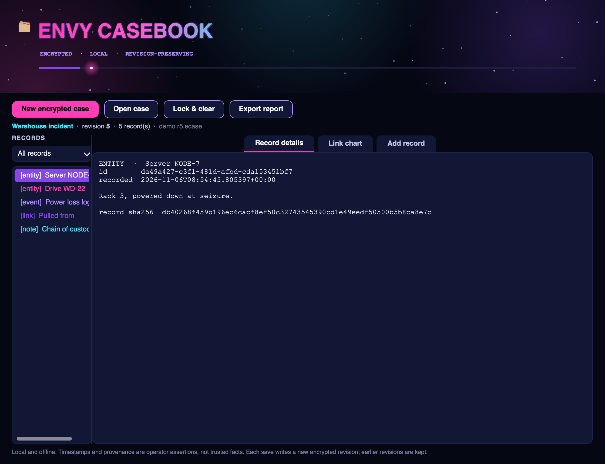
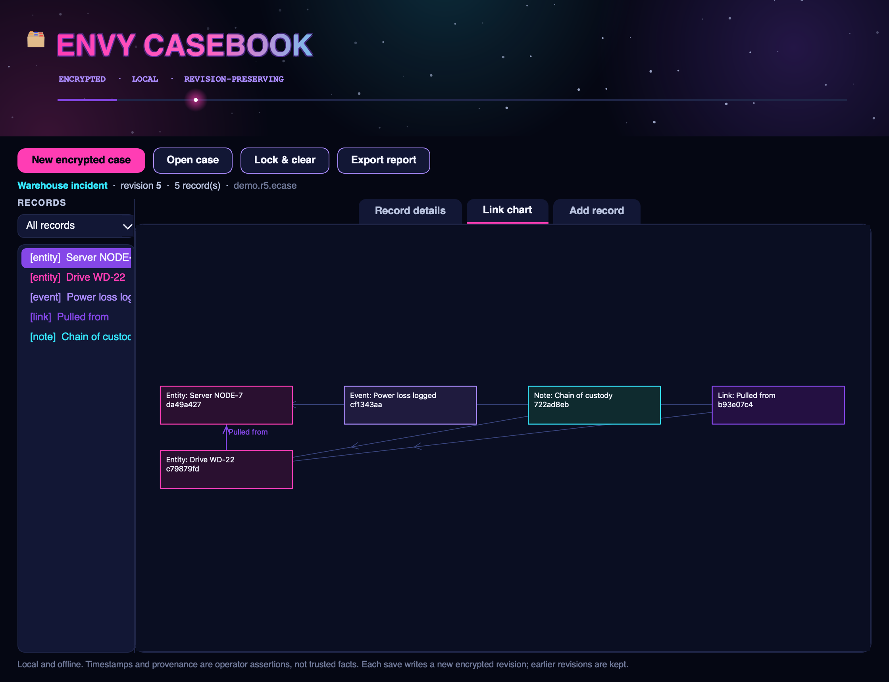

<p align="center">
  
</p>

<p align="center"><b>Keep encrypted case notes — entities, events and the links between them — in a real native app window.</b><br />
AES-256-GCM cases, a hash-chained revision journal, a link chart, event timelines and plaintext export. From ENVY BLACK VEIL, as a standalone app.</p>

<p align="center">
  <a href="https://github.com/xzchick/envy-casebook/actions/workflows/tests.yml"></a>
</p>
<p align="center">
  
  
  <br />
  
  
  
</p>

<p align="center">
  <a href="#install"><b>Install</b></a> ·
  <a href="#works-on">Compatibility</a> ·
  <a href="#using-it">Using it</a> ·
  <a href="#honest-by-design">What it isn't</a> ·
  <a href="#build--test">Build</a>
</p>

<p align="center">
  
</p>

<p align="center"><sub>A real native window — not a browser view. The title pulses, the stars twinkle, and a light travels the accent bar.</sub></p>

<a name="features"></a>




Create an encrypted case, then add **notes, entities, events and links**. Every save writes a **new encrypted revision**, chained to the last by SHA-256, so the history is preserved and tamper-evident — earlier revisions are never overwritten. The **Link chart** draws only the connections you entered (it infers nothing), the **Timeline** orders events by the UTC times you record, and you can **export** a plaintext HTML or JSON report whenever you choose.

<p align="center">
  
</p>

<a name="works-on"></a>


<p align="center">
  
  
  
</p>



### Requirements

| | 🍎 macOS | 🪟 Windows | 🐧 Linux |
|---|---|---|---|
| **OS version** | macOS 11 Big Sur or newer | Windows 10 or 11 (64-bit) | A current x86_64 or arm64 desktop |
| **Standalone bundle** | Nothing else to install | Nothing else to install | Standard desktop libraries (X11 or Wayland) |
| **From pip** | Python 3.10+ | Python 3.10+ | Python 3.10+ and a desktop session |
| **Dependencies** | `cryptography` + Qt (bundled) | `cryptography` + Qt (bundled) | `cryptography` + Qt (bundled) |
| **Network** | None, ever | None, ever | None, ever |

<a name="install"></a>


A **standalone bundle** that needs no Python, or **pip** if you already have Python 3.10+.

### Standalone bundle (no Python)

Download a bundle from the [latest release](https://github.com/xzchick/envy-casebook/releases/latest):

| File | System | Run it |
|---|---|---|
| `envy-casebook-v0.1.0-macos-arm64.tar.gz` | macOS (Apple Silicon) | `tar -xzf` it, then open `envy-casebook` |
| `envy-casebook-v0.1.0-windows-x86_64.zip` | Windows (64-bit) | Unzip, then run `envy-casebook.exe` |
| `envy-casebook-v0.1.0-linux-x86_64.tar.gz` | Linux (64-bit) | `tar -xzf` it, then run `./envy-casebook` |
| `envy_casebook-0.1.0-py3-none-any.whl` | Any OS with Python 3.10+ | `pip install` the wheel |
| `SHA256SUMS.txt` | — | Verify your download first |

Running `envy-casebook` with no arguments opens the window.

### From pip (Python 3.10+)

```sh
git clone https://github.com/xzchick/envy-casebook.git
cd envy-casebook
python3 -m venv .venv
. .venv/bin/activate          # Windows: .venv\Scripts\activate
pip install .
envy-casebook                  # opens the window
```

<a name="using-it"></a>


**In the window**

- **New encrypted case** → name it, choose a file and a passphrase (at least 12 characters).
- Open the **Add record** tab to add a note, entity, event or link; a link references exactly two existing records. **Add record & save revision** writes the next encrypted revision.
- Switch to **Link chart** to see the connections, or filter the record list to **Timeline (events)**.
- **Export report** writes a plaintext HTML or JSON copy — it is *not* encrypted.

**In the terminal**

```sh
envy-casebook new case.ecase --title "Warehouse incident"
envy-casebook template record.json --kind event        # make a record to edit
envy-casebook add case.ecase case.r1.ecase --record record.json
envy-casebook timeline case.r1.ecase                    # events in UTC order
envy-casebook export case.r1.ecase report.html --format html
```

Every command writes a **new** file and never overwrites an existing one, so each revision and export is kept.

<a name="honest-by-design"></a>


The encryption is real: cases are sealed with **AES-256-GCM** and a key derived from your passphrase with **scrypt**, the same envelope [ENVY Vault](https://github.com/xzchick/envy-vault) uses. What the Casebook does **not** do is just as important:

- **Timestamps and provenance are your assertions**, not trusted facts. Recorded and observed times come from your machine; the Casebook proves neither when something happened nor that it is true.
- **The link chart infers nothing.** It shows only the links and references you entered.
- **A plaintext export is plaintext.** Store and handle it under your own policy; the hash chain does not independently establish provenance or a trusted time.

> [!IMPORTANT]
> Keep your passphrase safe. There is no recovery: without it, an encrypted case cannot be opened.

<a name="build--test"></a>


```sh
python -m unittest discover -s tests -v          # unit tests (no display needed)
pip install pyinstaller build
python scripts/build_release_bundle.py           # standalone bundle + wheel + sdist + checksums
python scripts/smoke_test_release.py             # launch the built bundle and check it runs
```

CI runs all of this on Ubuntu, Windows and macOS for every push. Regenerate the README artwork with `python scripts/render_readme_art.py`.

<p align="center"><sub>MIT licensed. Part of ENVY BLACK VEIL, packaged as a standalone app. Offline; no telemetry, no network, no accounts.</sub></p>
